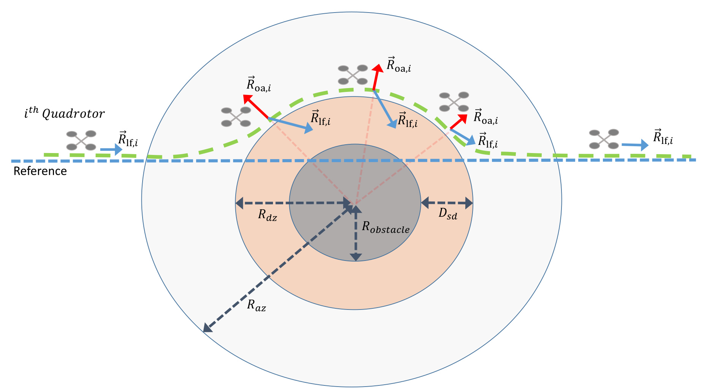
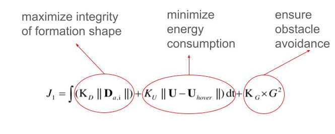
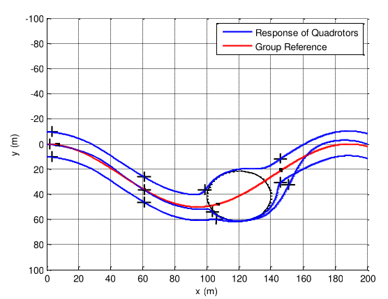

# Path Planning for Multiple UAVs

When quadrotors fly in formation, their capabilities improve significantly, allowing them to cover large areas more efficiently. This enhances their effectiveness in missions such as locating survivors in disasters (earthquakes, floods, and fires).

But how can we enable quadrotors to perform formation flight while avoiding obstacles in their path?

In my master's thesis, I addressed this problem by designing a path planning algorithm for quadrotors based on potential fields. As illustrated in Figure 1, when a quadrotor approaches an obstacle, the blue arrow represents a hypothetical attractive force corresponding to the desired trajectory, while the red arrow represents a hypothetical repulsive force generated by the obstacle's potential field. The resultant of these forces determines the desired waypoint for the quadrotor.

<figure>
    
    <figcaption><em>Fig. 1 - Interaction of attractive and repulsive forces in the potential field method.</em></figcaption>
</figure>

The key challenge is tuning the weights of these forces to ensure safety while maintaining formation integrity as much as possible. As depicted in Figure 2, I defined a cost function that ensures UAVs maintain a safe distance from obstacles while optimizing formation shape preservation and minimizing energy consumption.

<figure>
    
    <figcaption><em>Fig. 2 - Optimization cost function for formation flight.</em></figcaption>
</figure>

Once the optimization problem is formulated, any optimization solver can be used to find a solution. I implemented univariate search in MATLAB's optimization toolbox. As demonstrated in Figure 3, the quadrotors successfully maintain their formation while avoiding obstacles.

<figure>
    
    <figcaption><em>Fig. 3 - Resulting formation flight of quadrotors.</em></figcaption>
</figure>

To explore this further, check out [this paper](https://jast.ias.ir/article_114003_2b16e4be50bc0cecc7a755949715d457.pdf) and the simulation video I created in MATLAB/Simulink.

<figure class="project-video">
    <video controls preload="metadata">
        <source src="/assets/videos/drone_master_thesis2.mp4#t=30" type="video/mp4">
        Your browser does not support the video tag.
    </video>
    <figcaption>
        Simulations of the path planning algorithm.
    </figcaption>
</figure>
