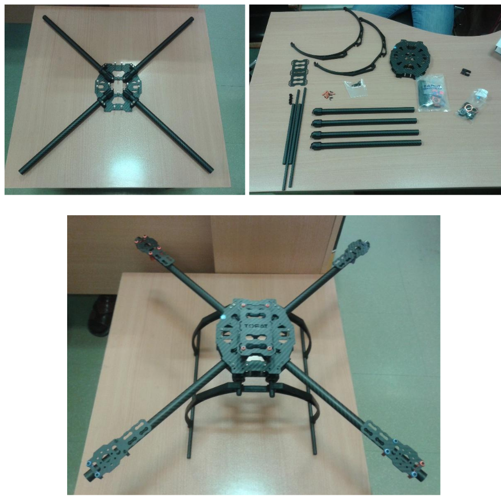
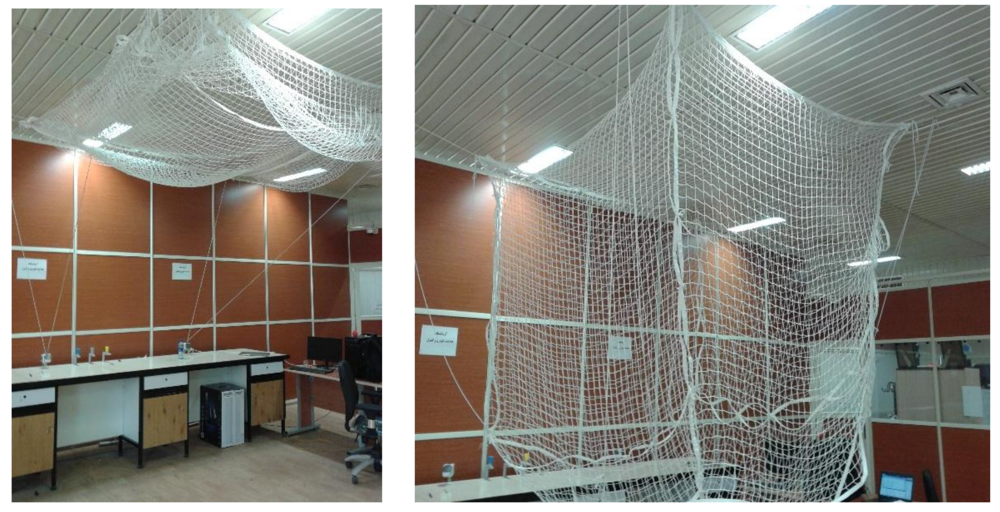
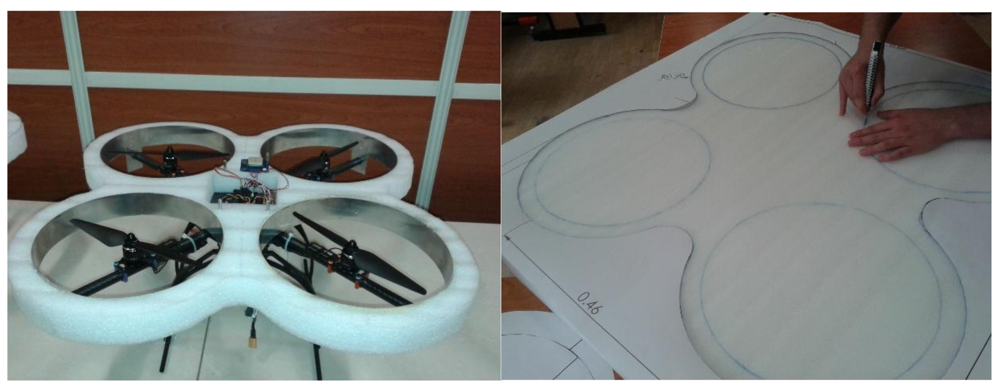

# Safety Measures for Testing Quadrotors

In 2013, when I joined the Guidance, Navigation, and Control Laboratory at the University of Tehran, our lab had recently acquired quadrotors. However, only individual parts were purchased, and we had to assemble them ourselves. My colleagues and I assembled the body frame, battery, electric motors, speed controller, and communication modules onto the quadrotor frame.

<figure><figcaption><em>Fig. 1 - Assembling the quadrotor frame.</em></figcaption></figure>

After assembling the quadrotors, we needed a proper testing environment. Testing quadrotors can be very risky due to the high rotational speed of the propellers, sometimes reaching 6000 RPM. Therefore, we designed and built a safe space for testing them. We built a foldable safety net that could be deployed and retracted within seconds.

<figure>
    
    <figcaption><em>Fig. 2 - Foldable safety net built for quadrotor testing.</em></figcaption>
</figure>

We also attached foam guards reinforced with aluminum strips around the propellers to prevent damage upon contact with surrounding objects.

<figure>
    
    <figcaption><em>Fig. 3 - Safety foam protection around quadrotor propellers.</em></figcaption>
</figure>

With these safety measures in place, we were able to significantly reduce the risks associated with working with our experimental quadrotors.
